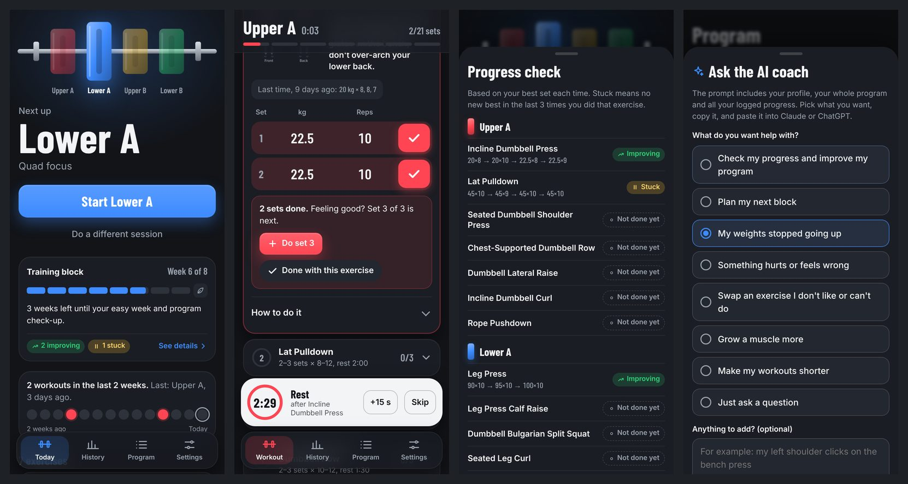
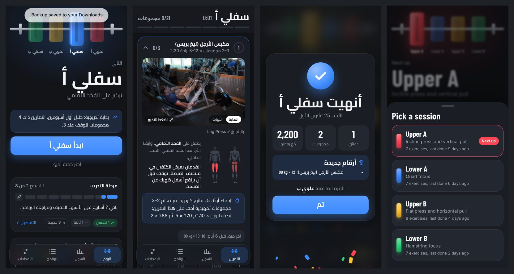

# Rolling Upper/Lower

A free workout app for a **rolling upper/lower hypertrophy split**. It installs on Android like a normal app, works in the gym with **no internet**, speaks **English and Arabic**, and comes with an **AI coach** prompt and optional **sync between your phone and computer**.

No accounts, no ads, no tracking. Your data stays on your devices and, if you turn on sync, on your own free Cloudflare server.




---

## Contents

1. [The idea](#the-idea)
2. [The training program](#the-training-program)
3. [How you progress](#how-you-progress)
4. [When to change your program](#when-to-change-your-program)
5. [Using the app](#using-the-app)
6. [The AI coach](#the-ai-coach)
7. [Install it on your phone](#install-it-on-your-phone)
8. [Sync between phone and computer](#sync-between-phone-and-computer)
9. [Back up and restore](#back-up-and-restore)
10. [Your data](#your-data)
11. [For developers](#for-developers)
12. [Credits](#credits)

---

## The idea

Most programs assume fixed days ("Monday is chest"). Real weeks don't work like that. This program **rotates** through four sessions in order, and you simply do the next one whenever you get to the gym:

**Upper A → Lower A → Upper B → Lower B → Upper A → …**

- Train **2 to 4 days a week**, any days, with gaps of 2–3 days when life happens.
- The app always knows which session is next, so there's nothing to plan.
- Each session is **6–8 exercises**, big compound lifts first, roughly an hour.
- Built for **muscle growth (hypertrophy)** in a full commercial gym.
- **Priorities:** chest and shoulders, then back and arms, plus abs.
- **Back-friendly:** no barbell squats, deadlifts or bent-over barbell rows. Rows are chest-supported, glutes are trained on the hip thrust machine, and every cue protects the lower back.

---

## The training program

Sets are the **target**. Every exercise starts with 2 sets and you add more up to the target when you feel good (see [How you progress](#how-you-progress)). Rest is in seconds. **SS** means superset with the next exercise: no rest between the two, rest after the second.

### Upper A: incline press and vertical pull

| # | Exercise | Sets | Reps | Rest |
|---|---|---|---|---|
| 1 | Incline Dumbbell Press | 4 | 6–10 | 150 |
| 2 | Lat Pulldown | 4 | 8–12 | 120 |
| 3 | Seated Dumbbell Shoulder Press | 3 | 8–12 | 120 |
| 4 | Chest-Supported Dumbbell Row | 3 | 10–12 | 90 |
| 5 | Dumbbell Lateral Raise | 3 | 12–20 | 60 |
| 6 | Incline Dumbbell Curl (SS) | 3 | 10–12 | 90 |
| 7 | Rope Pushdown | 3 | 10–15 | 90 |

### Lower A: quad focus

| # | Exercise | Sets | Reps | Rest |
|---|---|---|---|---|
| 1 | Leg Press | 4 | 8–12 | 150 |
| 2 | Leg Press Calf Raise (same machine, right after) | 4 | 10–15 | 50 |
| 3 | Dumbbell Bulgarian Split Squat | 3 | 8–12 / leg | 90 |
| 4 | Seated Leg Curl | 3 | 10–12 | 90 |
| 5 | Leg Extension | 3 | 12–15 | 90 |
| 6 | Kneeling Cable Crunch | 3 | 10–15 | 50 |
| 7 | Dead Bug | 3 | 8 / side | 50 |

### Upper B: flat press and horizontal pull

| # | Exercise | Sets | Reps | Rest |
|---|---|---|---|---|
| 1 | Barbell Bench Press | 3 | 6–8 | 150 |
| 2 | Pull-Up or Assisted Pull-Up | 3 | 6–10 | 120 |
| 3 | Chest-Supported Machine Row | 3 | 8–12 | 120 |
| 4 | Pec Deck Fly (SS) | 3 | 12–15 | 90 |
| 5 | Reverse Pec Deck (same machine) | 3 | 12–20 | 90 |
| 6 | Cable Lateral Raise | 3 | 12–15 / arm | 60 |
| 7 | Hammer Curl (SS) | 3 | 10–12 | 90 |
| 8 | Overhead Cable Triceps Extension | 3 | 10–15 | 90 |

### Lower B: hamstring focus

| # | Exercise | Sets | Reps | Rest |
|---|---|---|---|---|
| 1 | Hack Squat Machine | 4 | 8–12 | 150 |
| 2 | Lying Leg Curl | 4 | 8–12 | 90 |
| 3 | Hip Thrust Machine | 3 | 10–12 | 90 |
| 4 | Leg Extension | 3 | 12–15 | 90 |
| 5 | Seated Calf Raise | 4 | 12–20 | 50 |
| 6 | Hanging Knee Raise | 3 | 10–15 | 50 |
| 7 | Pallof Press | 3 | 10–12 / side | 50 |

Every exercise in the app has demonstration photos, a muscle map, a coaching cue and step-by-step instructions, in English and Arabic.

---

## How you progress

- **Warm up first.** The first exercise reminds you: 5 minutes of easy cardio, then lighter ramp-up sets (about 50% × 10, 70% × 5, 85% × 2).
- **Start with 2 sets.** After 2 sets the app asks "Feeling good? Set 3 of 4 is next." Do the extra sets on good days, stop at 2 on tired days.
- **Double progression.** Stay in the rep range. When you hit the **top of the range on every set**, the app tells you to add the smallest weight jump next time. Bodyweight exercises get "slow the lowering or add a pause" instead.
- **Last time is always shown.** Grey numbers in each set are what you did last time. Tap the tick without typing to repeat them.
- **Easing in.** For your first 2 weeks, exercises with 4 sets top out at 3 (can be turned off in Settings).
- **After a long gap** (7+ days), the app suggests about 10% less weight for that session.
- **Assisted pull-ups:** log the assistance as a negative weight, for example −20. Less assistance is progress.

---

## When to change your program

You don't change it every week. You **repeat the rotation** and beat your previous numbers. The app tells you when it's time:

**1. Training blocks.** The Training block card on Today shows one bar per week, 8 weeks by default (6–12 in Settings). It tells you how many weeks are left. When the bar is full:
- take an **easy week**: 2 sets per exercise, 10–20% lighter, stop each set with 2–3 reps left;
- then tap **Plan my next block with the AI coach** to update the program, and a new block starts.

**2. Exercise status.** The same card counts your exercises:
- **Improving:** the last time was a new best.
- **Steady:** no new best for one or two sessions, which is normal.
- **Stuck:** no new best in the last 3 times you did it (easy weeks don't count).

Tap **See details** for every exercise and its recent best sets. When **half or more of a session's exercises are stuck**, that session gets a **Needs an update** label. Ask the AI coach about it, or swap the stuck exercises.

Keep the big lifts for months. Swapping small exercises after a block or two is fine if you get bored.

---

## Using the app

### Today
- The barbell shows your four sessions as plates. The next one is lit up. Tap a plate (or **Do a different session**) to pick another one.
- **Start** begins the workout. Notes appear when relevant: easing in, a long gap, or an easy week.
- The **Training block** card, a strip of the last 14 days (each workout in its session's colour), and the list of exercises with photos.

### Workout
- Each exercise is a card. Open it to see the photos (tap to enlarge, with Play / Start / End), the muscle map, the cue, last time's numbers and the set rows.
- Type the weight and reps for each set, tap the tick. The tick animates, the progress ring and the bar at the top fill up.
- **What weight to write** (a reminder appears under the sets of each exercise):

  | Equipment | Write |
  |---|---|
  | Dumbbells | The weight of **one** dumbbell, not both added together |
  | Barbell | The total: bar plus all plates |
  | Machine with a weight stack | The number where the pin is |
  | Plate-loaded machine | All the plates you added |
  | Cable | The number where the pin is |
  | Bodyweight | Only extra weight you add, or leave it empty |

- **Machines marked in pounds:** tap **kg** above the weight column and pick **lb**. Type the number you see on the machine; the kg value appears under it, and that is what gets saved. The exercise remembers lb for next time (also in the exercise editor under **Weight unit**). Plates marked like "2.3 / 5" show both: 2.3 kg = 5 lb.
- The **rest timer** starts by itself, vibrates and beeps when rest is over. **+15 s** and **Skip** are on the timer.
- **Supersets** are linked: after a set of the first exercise you go straight to the second, then rest.
- **Add set**, remove extra sets, **Done with this exercise**, and **Undo done** if you tapped it by mistake.
- **Finish workout** shows a summary: minutes, sets, kg lifted and any new bests.
- The screen stays on during workouts (can be turned off in Settings).

### History
- **Workouts:** every workout on a timeline. Open one to see all sets, **Change date** (for a workout you logged later) or delete it.
- **Exercises:** each exercise with a progress line (your heaviest set each time, or total reps for bodyweight work).
- Exercises set to **lb** show their weights in lb everywhere in History, with kg in brackets (for example `110 lb (49.9 kg) × 12`). This also applies to workouts you logged in kg before switching the exercise to lb.

### Program
- **AI coach** panel (see below).
- Each exercise shows its **photo**. Tap it to see the movement full screen; tap the name to edit.
- **Reorder by dragging:** hold the **dotted handle** (⠿) on the left of a session or exercise and drag it up or down. While you drag a session, all sessions fold to their titles so they fit on the screen. The page scrolls by itself when you reach the top or bottom. With a keyboard, focus the handle and press the up or down arrow.
- The session order is the rotation order, shown at the top of the page (for example Upper A › Lower A › Upper B › Lower B).
- Edit, add or delete exercises and sessions.
- **Swap for another exercise:** open an exercise, tap **Swap for another exercise**, and the library opens on the same muscle. Pick one and tap **Save**. Sets, reps, rest and superset stay the same; the photo, steps, muscles and Arabic text come from the new exercise. The new exercise starts its own history; the old one's history stays in History.
- Deleted an exercise or session by mistake? Tap **Undo** on the message that appears (it stays for about 8 seconds).
- **Add exercise** opens a built-in library of **873 exercises** that works offline. You don't need to know names:
  - filter by **muscle** (chest, shoulders, lats, quads, hamstrings, glutes, calves, abs, …) and **equipment** (machine, cable, dumbbell, barbell, bodyweight, other);
  - each exercise shows its muscles, equipment, compound or isolation, and difficulty;
  - tap the photo to preview the movement full screen, tap the name to add it;
  - **Show more** pages through the list, 30 at a time; gym equipment comes first;
  - stretches, cardio, jumps and Olympic lifts are hidden unless you tick the box;
  - or search by name (in English or Arabic), or start from a blank exercise.
  - In Arabic every library exercise has an Arabic name and Arabic steps, filled in automatically when you add it. Exercises you added earlier in English show in Arabic too, unless you renamed them or edited their steps.
- For each exercise: name (and Arabic name), target sets, reps, rest, cue, steps, main and secondary muscles, superset, bodyweight-only, weight unit (kg or lb), and the photo (library photo, your own photo, or none).
- Sessions have a name, focus and plate colour.

### Settings
- **Language:** English or العربية (the whole app switches to right-to-left).
- **Theme:** dark, light, or follow the phone.
- **Your profile:** weight, height, age, goal, experience, injuries, priorities, gym, schedule. The AI coach uses it, and your weight history is kept.
- Keep screen on, easing in, **training block** length, start or end an **easy week**.
- **Sync between devices**, **photos for offline use**, **back up**, **restore**, reset the program, delete history.

### Small things
- Android's **back button** closes photos and panels instead of leaving the app.
- Animations respect the phone's "remove animations" setting.

---

## The AI coach

You don't need to know what to ask. The app writes the prompt for you.

1. **Program → Ask the AI coach.** Pick what you want:
   - Check my progress and improve my program
   - Plan my next block
   - My weights stopped going up
   - Something hurts or feels wrong
   - Swap an exercise I don't like or can't do
   - Grow a muscle more
   - Make my workouts shorter
   - Just ask a question
2. Add a note if you like, tap **Copy prompt**, paste it into Claude or ChatGPT.
3. Copy the coach's **whole reply**, then **Program → Import reply → Check the import →** confirm.

When the reply is a **list of exercises for one session**, the check shows which session they go into (you can change it) and asks how:
- **Replace all** (the default): the session's exercises become exactly the coach's list, in that order.
- **Add to end**: the coach's exercises are added after the ones already there.

Either way, tap **Undo** on the message after importing to get the old list back.

The prompt contains your profile, how the app works, your whole program, your training log (frequency, recent workouts), every exercise's recent sets and best set, which exercises are improving or stuck, and the exact reply format. In Arabic mode the coach is asked to explain in Arabic and include Arabic exercise text.

Exercises that keep the **same name keep their history**. Steps, photos, Arabic text and the lb setting you already have are kept when the coach leaves them out. The prompt also tells the coach how you log weight (one dumbbell, the stack number, barbell total) and which machines are in pounds.

<details>
<summary>Reply format the app imports</summary>

A full program:

```json
{
  "name": "Program name",
  "sessions": [
    {
      "name": "Upper A",
      "focus": "Short description",
      "exercises": [
        {
          "name": "Incline Dumbbell Press",
          "sets": 4,
          "reps": "6-10",
          "rest": 150,
          "cue": "One short coaching cue",
          "steps": ["Step one", "Step two"],
          "primary": ["chest"],
          "secondary": ["front-delts", "triceps"],
          "library": "Incline Dumbbell Press",
          "supersetWithNext": false,
          "noWeight": false,
          "ar": { "name": "Arabic name", "cue": "Arabic cue", "steps": ["Arabic step"] }
        }
      ]
    }
  ]
}
```

Or one session's complete list of exercises, in order: `{"session": "Upper B", "exercises": [ ... ]}`. By default this replaces that session's exercises (see above).

- Muscles: `chest, front-delts, side-delts, rear-delts, traps, upper-back, lats, lower-back, biceps, triceps, forearms, abs, obliques, glutes, quads, hamstrings, adductors, calves`.
- `library` is the name of an exercise in [Free Exercise DB](https://github.com/yuhonas/free-exercise-db), used for the photos.
- The importer reads the last ` ```json ` block in the reply, so the explanation around it is fine.
</details>

---

## Install it on your phone

The app is a website that installs itself (a PWA). It needs to be online once; GitHub Pages hosts it for free.

### Put it online (once)
1. Create a repository on GitHub, for example `workout`. Leave "Add README" off.
2. Click **uploading an existing file** and drag in **everything inside this folder** (not the folder itself). Click **Commit changes**.
3. **Settings → Pages →** Branch: `main`, folder `/ (root)` → **Save**.
4. After a minute your app is at `https://YOUR-NAME.github.io/workout/`.

### Install on Android
1. Open the link in **Chrome** with internet on and wait about 10 seconds.
2. Menu **⋮ → Install app** (or **Add to Home screen**).
3. Open it once more online. From then on it works with **no internet**.

Before your first gym day, test it in **airplane mode**. Settings → **Photos for offline use** shows whether photos for exercises you added are saved; the photos of the original program are built in.

### Updating
Upload the changed files to the same repository. If you edited the code yourself, run `node tools/build-sw.mjs` first (see [For developers](#for-developers)). Phones download the update the next time the app opens online and show "App updated. Close and reopen it". Your data stays.

---

## Sync between phone and computer

Each browser keeps its own copy of your data, so your computer doesn't see what you logged on your phone until you set up sync. The sync server is free, always on, and yours. The first device that syncs becomes the owner; other devices join with a link.

### Part 1: make the server on Cloudflare (once, about 5 minutes)

1. **Make the Worker:** dashboard → **Workers & Pages → Create application → Start with Hello World! → Get started** → name `workout-sync` → **Deploy**. If it asks for a workers.dev subdomain, type any name.
2. **Put in the code:** **Edit code**, delete everything, paste [`sync-server/cloudflare-worker.js`](sync-server/cloudflare-worker.js), **Deploy**.
3. **Make the storage:** **Storage & Databases → Workers KV → Create instance** → name `workout-data` → **Create**.
4. **Connect it:** **Workers & Pages → workout-sync → Bindings → Add binding → KV namespace → Add binding** → Variable name `DATA` (capitals) → namespace `workout-data` → **Add binding**.
5. **Check it:** open the Worker's address (it ends in `.workers.dev`). You should see `"storage":true`.

### Part 2: your phone first (it has your workouts)
Settings → **Sync between devices** → paste the Worker's address → **Save and sync now**. The app makes your private sync code by itself and shows "Last synced just now".

### Part 3: your computer and other devices
On the phone: **Copy link for another device**. Open that link on the computer and confirm. You can also paste the whole link into **Server address** and tap Save.

### How it behaves
- Syncs when the app opens, when you come back to it, after you finish a workout, and after you change the program, profile, dates or history.
- Offline? Nothing is lost; it catches up when you're online.
- Workouts from all devices are combined. Deleting or re-dating a workout on one device does the same on the others.
- For the program and profile, the most recent change wins.
- Theme, language and screen settings stay per device. Your own photos are not synced (use Back up).
- **Turn off sync** keeps the code, so you can turn it back on.

### What you see in Workers KV
| Key | What it is |
|---|---|
| `owner` | A fingerprint (SHA-256) of your sync code. Not the code itself. |
| `data:<fingerprint>` | Your synced data. |
| `data:<fingerprint>:previous` | A safety copy from before the last save. |
| `data:<other fingerprint>` | A leftover from an older code. Safe to delete. |

### If something goes wrong
- **"Add a KV binding named DATA"**: redo step 4; the name must be `DATA`.
- **"This device's code doesn't match the server"**: on a device that syncs, tap **Copy link for another device** and open it on this one.
- **"This server already belongs to your other device"**: same fix, use the link.
- **No device syncs any more**: in Workers KV → `workout-data`, delete the `owner` key, then **Save and sync now** on your phone and connect the others with the link. Each device keeps its own data, so nothing is lost.

### Using your own Node.js server instead
[`sync-server/server.js`](sync-server/server.js) is the same server for any Node.js 18+ host, with no packages to install. Start it with `node server.js`; the port comes from `SERVER_PORT` or `PORT`, and data is saved in `./data`. `sync-server/botkeep-upload.zip` contains it, ready for panels like Botkeep.

It only works if the host gives it an **https://** address, because browsers block an https app from talking to a plain `http://IP:port` server. If a `public` folder sits next to `server.js`, it also serves the app itself.

---

## Back up and restore

- **Settings → Back up** opens Android's share menu: pick **Google Drive** to keep the file there. **Save to phone** downloads it instead.
- The backup contains your program, workouts, settings, profile, weight history and your own photos.
- **Restore** replaces what's on the device with the backup file.
- Do it every week or two even with sync, because it's the only copy of your own photos.

Health Connect, Google Fit and the Fitbit / Google Health API were considered for "saving progress to Google". Google Fit's APIs are being shut down, Health Connect only works for apps from the Play Store and doesn't store the weight of each set, and Google Health isn't accepting new projects. A Drive backup plus your own sync server does the job without any of those limits.

---

## Your data

Everything lives in the browser on each device:

| Where | What |
|---|---|
| `localStorage` `rul.program` | Your program (sessions, exercises, Arabic text) |
| `localStorage` `rul.log` | Finished workouts, plus the ids of deleted ones |
| `localStorage` `rul.current` | The workout in progress (not synced) |
| `localStorage` `rul.settings` | Settings, profile, training block, easy week, sync address and code |
| `localStorage` `rul.body` | Body weight history |
| `localStorage` `rul.ratios` | Photo shapes, so photos aren't cropped |
| IndexedDB `rul` / `photos` | Your own photos |
| Cache Storage | The app and exercise photos for offline use |

Nothing is sent anywhere except to your own sync server, and only if you set it up. The sync code is the password to that server, so keep the "link for another device" private.

---

## For developers

Plain HTML, CSS and JavaScript. No framework and no build step for the app itself.

### Project structure
```
index.html              Page shell: timer, sheets, viewer, nav
styles.css              Design tokens, dark/light themes, RTL, animations
app.js                  The whole app: views, workout logic, AI coach, import, sync, backup
i18n.js                 English and Arabic interface text
program.js              The default program, with Arabic text for every exercise
library.js              Free Exercise DB index: 873 exercises (names, muscles, equipment, steps)
library-ar.js           Arabic names and steps for the library, keyed by exercise id
sw.js                   Service worker (generated by tools/build-sw.mjs)
manifest.webmanifest    PWA manifest
img/                    Built-in photos for the default program (2 per exercise)
icons/                  App icons
fonts/                  Barlow Condensed (Latin) and Cairo (Arabic)
sync-server/            Sync server: cloudflare-worker.js and server.js (Node)
tools/build-sw.mjs      Rebuilds sw.js after you change files
docs/                   Screenshots for this README
```

### Run it locally
```bash
npx serve .            # or: python3 -m http.server 8080
```
Open the printed address. Service workers work on `localhost`. Sync accepts `http://localhost` and `http://127.0.0.1` servers for testing; everything else must be `https://`.

### After changing any app file
```bash
node tools/build-sw.mjs
```
It lists every file the app needs offline and sets a new version from a hash of their contents. Without it, installed phones keep the old cached version. `sync-server/`, `tools/`, `docs/` and `README.md` are not cached.

### Offline strategy
- App files are precached on install and served cache-first. A new `sw.js` version replaces the cache and the app shows an "updated" message.
- Exercise photos from Free Exercise DB (`raw.githubusercontent.com`) are cached the first time they load; **Settings → Download now** fetches all photos the program uses. Library search thumbnails are never stored.

### Data model
```js
// A finished workout in rul.log.sessions
{ id: 'w1792900000000', sessionId: 'upper-a', name: 'Upper A', color: 'red',
  start: 1792900000000, end: 1792903000000,   // easy: true during an easy week; editedAt after a date change
  entries: [{ exId: 'incline-dumbbell-press', name: 'Incline Dumbbell Press', reps: '6–10',
              targetSets: 4, noWeight: false, sets: [{ w: 22.5, r: 10 }, { w: 22.5, r: 9 }] },
             { exId: 'leg-press', name: 'Leg Press', reps: '8–12', targetSets: 4, noWeight: false,
               unit: 'lb', sets: [{ w: 49.9, lb: 110, r: 12 }] }] }
```
- Exercise ids are slugs of the English name, which is why keeping a name keeps its history.
- `w` is always kg (negative for assistance, `null` for bodyweight); `r` is reps.
- Exercises logged in pounds have `unit: 'lb'` in the program and on the entry; each set also keeps the pound number in `lb`, and `w` is that converted to kg (rounded to 0.1).

### Sync protocol
Both servers implement the same tiny API. Every request carries `Authorization: Bearer <sync code>`.

| Request | Body | Response |
|---|---|---|
| `GET /v1/ping` | | `{ ok, claimed }` (no code needed) |
| `GET /v1/data` | | `{ rev, updatedAt, data }` (`{ rev: 0, data: null }` when empty) |
| `PUT /v1/data` | `{ baseRev, data }` | `{ rev }`, or `409` with the newer `{ rev, data }` |

The app pulls, merges, and pushes; on `409` it merges again and retries. Merging is safe to repeat in any order:
- workouts: union by id; a newer `editedAt` wins; ids in `log.deleted` are removed everywhere;
- program: newest `programAt` wins; shared settings (profile, block, easy week): newest `sharedAt` wins;
- body weight: one entry per day, latest wins.

### Adding a language
Copy the `en` block in `i18n.js` to a new key, translate it, add muscle names to `MUSCLE_NAMES`, and add a button to the Language setting in `viewSettings()` in `app.js`. For right-to-left languages set `dir: 'rtl'`. For library exercise names and steps, add a file like `library-ar.js` (`window.LIBRARY_AR = { id: [name, [steps…]] }`).

---

## Credits

- Exercise photos and the exercise library: [Free Exercise DB](https://github.com/yuhonas/free-exercise-db), released into the public domain (Unlicense).
- Fonts: [Barlow Condensed](https://fonts.google.com/specimen/Barlow+Condensed) and [Cairo](https://fonts.google.com/specimen/Cairo), SIL Open Font License.
- Program, app and Arabic text written with Claude.

This app is a training log, not medical advice. If something hurts, stop and see a doctor or physiotherapist.
